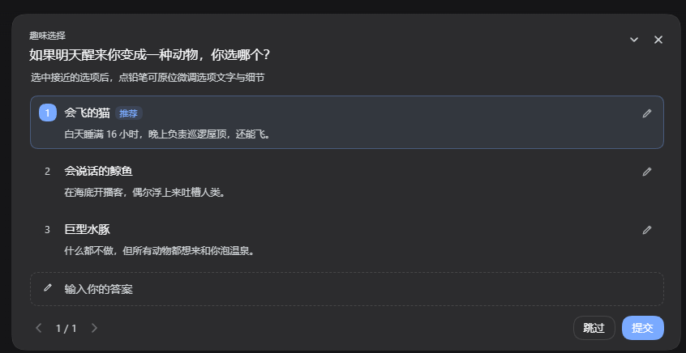
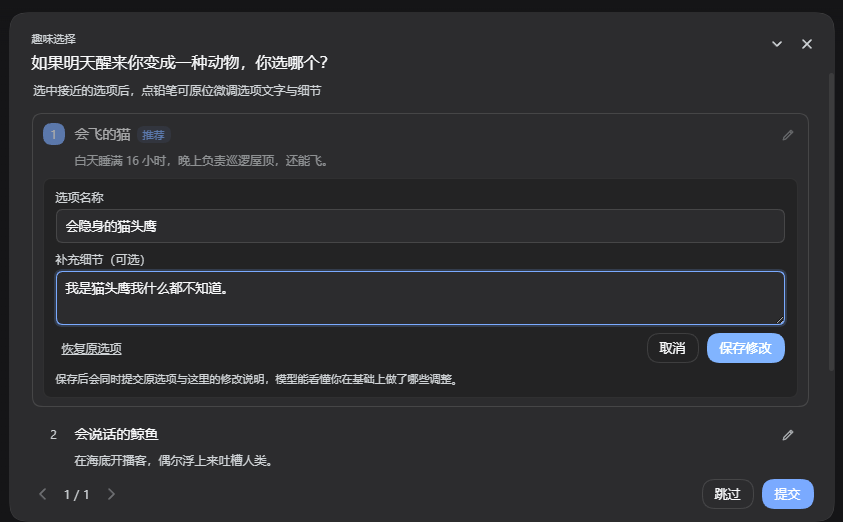
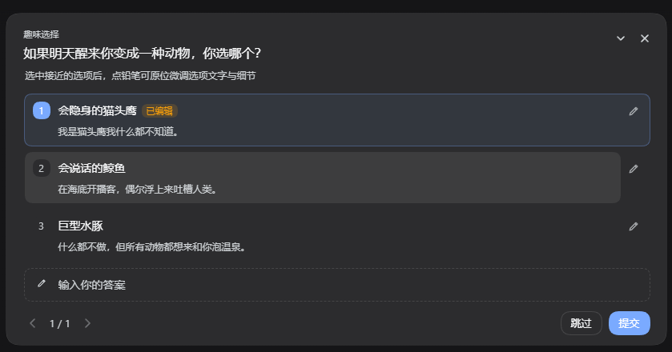

# dsh-editable-question-options

English | [中文](#中文)

A DeepSeek Harness Web plugin that makes `ask_user_question` option cards editable before you answer.

When an agent asks a choice question, the option closest to what you want often needs a small adjustment. The stock card only lets you pick an option or type a separate custom answer. This plugin adds a pencil to every option: pick the closest choice, edit its label and details in place, save, and submit the original option together with your revision.

## Screenshots

**Pick the closest option** — every option has a pencil:



**Edit the label and details in place**:



**Save and submit** — the option is selected and marked Edited; the answer keeps the original choice plus your revision:



## What it does

- Takes over the composer for generic `ask_user_question` requests that offer options.
- Adds a pencil action to each option; it opens an inline editor for the option label and its optional description.
- Saving selects that option and shows an **Edited** badge on the card.
- Submitting keeps the **original** option label in `selected` and sends the revision in the question's `custom` note, so the model sees both the base choice and what changed.
- Keeps the shipped behavior for multi-question paging, multi-select, the free-text answer, skip, the timed countdown (`Take time`), minimize/close, and post-timeout answering.
- Declines plan-review cards, read-only answered cards, and questions without options; those stay on the shipped UI.
- Has a small error-boundary fallback so a rendering failure can still skip the batch or close the panel instead of stranding the agent.

## Install

Requires a DSH Web/Desktop build with the `conversation.composer` chain. Tested on DSH **0.2.1-rc.3** and **0.2.2-rc.5**; other releases are unverified.

From npm:

```sh
dsh plugin --profile <profile> add dsh-editable-question-options
```

From GitHub (the repository ships plain JavaScript, so no build step or `allowBuilds` permission is needed):

```sh
dsh plugin --profile <profile> add github:CarviS0302/dsh-editable-question-options
```

Pin a release tag:

```sh
dsh plugin --profile <profile> add github:CarviS0302/dsh-editable-question-options#v1.0.1
```

If you prefer the Plugins page, use **Plugins → Add plugin** and point it at the checkout.

If an earlier local build named `@local/editable-question-options` is already installed, remove it first (`dsh plugin --profile <profile> remove @local/editable-question-options`); both bundles use the same plugin row id.

## Usage

1. Let an agent ask a question with options.
2. Click the pencil next to the closest option.
3. Adjust the option label and, if needed, the details; press **Save changes**.
4. The option is selected and marked **Edited**; submit the answer as usual.

The submitted answer looks like this:

```json
{
  "answers": [
    {
      "id": "question-id",
      "selected": ["Option B"],
      "custom": "Option \"Option B\" edited to: Option B+ stable-first, use port 8080 (based on Option B, change the service port)"
    }
  ]
}
```

The exact `custom` wording follows the UI language (Chinese or English).

## Compatibility and conflicts

- Declares `engines.dsh: >=0.2.1-rc.3 <0.3.0-0`. DSH's host compatibility gate enables semver prereleases, so this range covers the tested 0.2.x releases while gating 0.3.x until it is verified. The plugin still declines a question carrier it does not recognize at runtime and lets the shipped card take over. Tested on 0.2.1-rc.3 and 0.2.2-rc.5; changes to the composer or question-carrier contract may still require an update.
- Do **not** install this together with `dsh-question-note` or `dsh-better-choice`. All three take over the same composer chain; those plugins register at priority `-10`, so they would win and this plugin would stay inactive. This plugin registers at priority `-1`, between the subagent takeover (`-10`) and the shipped question card (`0`).

## Limitations

- Unsubmitted edits are component-local: reloading the page while the card is open loses the edit. The question itself remains answerable from its tool-call row.
- `question.detail` is rendered as plain text instead of Markdown.
- Only Simplified Chinese and English UI strings are registered.
- The plugin intentionally does not change the Host tool or the model-facing answer schema.

## How it works

- The browser half registers one entry in the `conversation.composer` chain and elects itself only for a live generic question carrier that offers at least one option.
- The card is a plain-JavaScript reimplementation of the shipped generic question flow (paging, multi-select, custom answer, skip, countdown, channel handling), with an inline option editor.
- Answer items keep the original option labels in `selected`; edited options are folded into `custom`. This uses the existing answer protocol, so no Host changes are required.
- The Host half is intentionally empty; it exists so the bundle has a host row whose `dsh.client` declaration loads the browser half.

## Security

- No network requests, telemetry, credentials, or install scripts.
- Reads only the pending question object and submits through DSH's existing answer channel.
- No other plugin or profile configuration is modified.

## 中文

一个 DSH Web 插件：让 `ask_user_question` 的选择题卡片在提交前可编辑。

原卡片只能“选一个”或“另外填写自定义答案”。启用后，每个选项右侧会多一个铅笔按钮：先选最接近的选项，再就地修改它的名称和细节，保存后该选项被选中并显示“已编辑”；提交时保留原选项 label，并把修改说明放进该题的 `custom`，模型能同时看到基础选项和你的调整。

保留原有行为：多题翻页、多选、自由文本、跳过、倒计时/慢慢回答、收起面板、超时后续答。计划审批卡片、已回答的只读卡片、没有选项的问题仍由官方界面处理；另外有渲染失败兜底，可选择跳过或收起面板，不会让 agent 永久卡住。

### 安装

已在 DSH 0.2.1-rc.3、0.2.2-rc.5 验证。仓库内是纯 JS，无需构建，也不需要 `allowBuilds`。

从 npm 安装：

```sh
dsh plugin --profile <profile> add dsh-editable-question-options
```

从 GitHub 安装：

```sh
dsh plugin --profile <profile> add github:CarviS0302/dsh-editable-question-options
```

固定版本：

```sh
dsh plugin --profile <profile> add github:CarviS0302/dsh-editable-question-options#v1.0.1
```

### 使用

等 agent 弹出带选项的问题 → 点最接近选项右侧的铅笔 → 修改名称/细节 → 保存 → 提交。

### 冲突与限制

- 声明 `engines.dsh: >=0.2.1-rc.3 <0.3.0-0`。DSH 宿主的兼容检查会放行预发布版本，因此这个范围覆盖已验证的 0.2.x，并在 0.3.x 验证前先挡住；插件本身遇到不认识的 carrier 仍会让位给官方卡片。
- **不要与 `dsh-question-note` 或 `dsh-better-choice` 同时安装**：它们和本插件都接管同一个 composer 链，并且注册在 priority `-10`，会先赢，导致本插件不生效。本插件注册在 `-1`（subagent 为 `-10`、官方问题卡片为 `0`）。
- 未提交的编辑不会持久化，刷新页面会丢失；问题本身仍可从工具调用行重新打开。
- `question.detail` 按纯文本渲染，不渲染 Markdown。
- UI 文案目前只有简体中文和英文。

### 安全

无网络请求、无遥测、无凭据读取、无安装脚本；只读取当前待回答的问题对象，并通过 DSH 原有答案通道提交。

## License and attribution

MIT. The question-card behavior was informed by the MIT-licensed DeepSeek Harness packages (notably `@deepseek-ai/dsh-client-ui-user-questions`); this plugin is an independent plain-JavaScript implementation and bundles no DSH build artifacts. Icon artwork is original. See [NOTICE.md](NOTICE.md).
